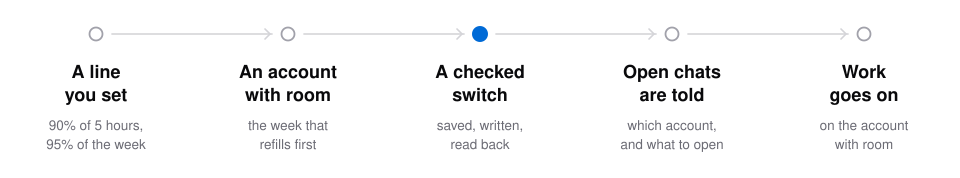
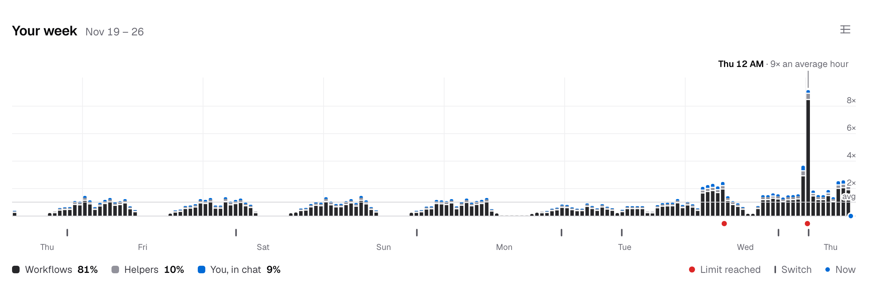

# <picture><source media="(prefers-color-scheme: dark)" srcset="docs/logo-dark.svg"></picture>

### Maximize your AI subscriptions.

A telephone switchboard put every call through on an open line. This one does it for your coding agents: every session lands on a subscription with room.

- **Every subscription, used.** Claude Code moves between your accounts on its own, before a limit stops you. It uses up the one that resets soonest first, so less of what you paid for goes to waste. No `/login`.
- **Model-agnostic.** Some people swear by Codex, some by Claude. Switchboard doesn't care: both sit on one board, and one command carries a chat from one to the other.
- **Bang for your buck.** Not every job needs your most expensive model. One switch runs your helper agents on a cheaper model, so your best model's quota goes to the work that needs it. Your week shows where the tokens went.

```sh
brew install amyjainberkeley/apps/switchboard
```

macOS, with Claude Code. Codex is optional. No admin password. Then type `switchboard`.

**Privacy first.** It runs on your Mac and nowhere else. There is no server, nothing is tracked, and your logins are stored only on your Mac. [How to check](#privacy).

https://github.com/user-attachments/assets/5f6777d8-38f3-4380-81a6-9b7d1ae51000

One scene in the film, Models by the job (lookups on Haiku, reviews on Sonnet), comes in the next update.

<picture><source media="(prefers-color-scheme: dark)" srcset="docs/screenshot-dark.png"></picture>

## Why

I pay for four Claude accounts. Every few hours one of them hit its limit in the middle of something, while another sat there full. So: `/login`, a browser tab, pick the other account, find my place again. Then an artifact I published an hour ago says "Page not found", because now I'm signed in as the other me. And at the end of the week I couldn't tell you where any of it went.

It was silly that nothing fixed this, so I built it. In Hindi it's called *paisa vasool*: getting your money's worth.

## Quick start

**1. Install** with the line at the top, or [without Homebrew](#install).

**2. Type `switchboard`.** The first time, it walks you through setup in your terminal, in a few numbered steps, and starts like this:

```
Switchboard setup.

1 of 4  Your account
  Claude Code is signed in as maya@northwind.example. Kept.

2 of 4  Your other accounts
```

Your other accounts sign in through your browser, on Anthropic's own page, one after another. If Codex is on your Mac, setup offers to add it. Then it offers to move Claude Code to another of your accounts, so you see a switch happen.

**3. Get back to work.** With two accounts in, auto-switch is already on. Type `switchboard` to see every account and its limits, or `switchboard page` for the whole board in your browser. `switchboard add` adds an account later, `switchboard setup` runs the first run again, and a `/login` in Claude Code is still kept by itself.

## How it works

<picture><source media="(prefers-color-scheme: dark)" srcset="docs/switch-dark.svg"></picture>

- **It watches every limit.** Each account's 5-hour and weekly numbers are read from Anthropic every 5 to 15 minutes. In a terminal, the account you're on is live, straight from Claude Code.
- **It moves at a line you set.** 90% of the 5-hour limit or 95% of the week, until you change them. In a terminal that takes about a minute. A move that isn't urgent waits until Claude Code is idle.
- **Every switch is a transaction.** It writes a journal, writes the new login, reads it back, and puts the old one back if anything doesn't match. Kill it halfway and it finishes or undoes the switch at the next start.
- **Your sessions come along.** New ones start on the new account and open ones follow in about 30 seconds. An artifact still opens as the account that made it.
- **When Claude is out, you keep going.** `switchboard continue` hands the chat to Codex, with a note written on your Mac. `switchboard claude` runs Claude Code on your own API keys. If nothing has room, it tells you when the first account resets.

Every switch and its reason is in `switchboard log`. `switchboard auto why` says what it would do right now. More in [how it works](docs/how-it-works.md#auto-switch).

## Your week

<picture><source media="(prefers-color-scheme: dark)" srcset="docs/week-dark.png"></picture>

Seven days by the hour, split into you, your helpers and your workflows, with every limit and every switch marked. Then by project, by agent and by model, and a line like "48% of the use was re-reading context" when that is the biggest share. `switchboard usage` prints the shares in the terminal, and ends with how much of the week would move to a cheaper model if your helpers ran there. `switchboard models on` moves them.

It's all worked out on your Mac, from files already on it.

## Privacy

Switchboard holds the logins to your AI plans, so here is exactly what it does with them.

| | What happens | Check it yourself |
|---|---|---|
| **Keeps** | Your logins, in your macOS login Keychain. Its own files hold fingerprints of them, not the logins. The exceptions are in the list below. | `security find-generic-password -s "Switchboard login"` |
| **Sends** | Each login's tokens to the company that issued them, and nowhere else. For a Claude account that means Anthropic: to renew the login and to read that account's limits. | The addresses are in `switchboard/accounts/facts.py` |
| **Your prompts and code** | They don't pass through Switchboard. Claude Code talks to Anthropic directly; Switchboard changes which of your logins it finds. The two exceptions are commands you start yourself: `switchboard claude` (your own API keys, through a gateway on this Mac) and `switchboard continue` or `hand` (a note of the chat, or the job, goes to Codex after your yes for that folder). | `switchboard/accounts/switcher.py` |
| **Listens** | On `127.0.0.1` only. A web page can't read it or change anything. A program already running on your Mac can use it. | `curl -i -H "Host: example.com" http://127.0.0.1:7799/` answers 403 |
| **Never** | No telemetry, no analytics, no crash reports. Nothing updates by itself. Nothing asks for an admin password. | `switchboard about` |

The account engine is 25 files of standard-library Python, and its tests run on made-up accounts in throwaway folders. `switchboard about` prints what your install is and what it put on your Mac. `switchboard demo` shows the real page with made-up accounts and changes nothing.

Not done yet, and written down: the curl install isn't checked against a checksum (Homebrew's is), and the apps aren't signed with a Developer ID. [SECURITY.md](SECURITY.md) has the full list.

<details>
<summary>Every address it contacts</summary>

- `platform.claude.com`: to renew a saved login. The request carries that login's refresh token and Claude Code's own public client id, and names Switchboard as its user agent.
- `api.anthropic.com`: to read an account's limits, and to confirm whose login a login is.
- `github.com` and `raw.githubusercontent.com`: when you install or update. A look for a newer version is off until you turn it on (`switchboard config set update_check daily`); it, and `switchboard update --check`, ask only the place an update would come from, for its version number.
- `pypi.org` and `files.pythonhosted.org`: at install, for the two PyObjC packages of the menu bar item, pinned by hash. When the Mac has no Python it can use, Switchboard's own Python comes from a GitHub release and is checked against a pinned SHA-256.
- The code and font sites claude.ai allows (`cdnjs.cloudflare.com`, `cdn.jsdelivr.net`, `unpkg.com`, `cdn.tailwindcss.com`, `code.jquery.com`, `fonts.googleapis.com`, `fonts.gstatic.com`): a preview of a page you published loads that page's own scripts and fonts, as your browser does when you open it.
- Only when you turn them on: the provider address of each API key you add; OpenAI, through Codex, after your yes for a folder; the download sites of claude-mem and the Code map (`registry.npmjs.org`, `nodejs.org` and `github.com` releases), which the page lists before you say yes.

Signing in and opening an artifact happen in your browser and in Claude Code, which make their own requests.

</details>

<details>
<summary>What it keeps and reads on your Mac</summary>

- Logins and API keys stay in your Keychain, except in a file you ask for: `switchboard export` writes your accounts' logins to one file protected with a passphrase, to carry to another Mac. Switchboard's own files keep only each key's name and last four characters, and no login, unless the Keychain refuses one: then a recovery copy goes in a file only you can read.
- The Keychain also keeps up to two earlier logins for each account, so a login replaced by a stale copy can be put right.
- When Claude Code keeps its own login in the plain file `~/.claude/.credentials.json`, a switch writes the new login there too, and Switchboard reads that file when Claude Code's Keychain item is empty. It never creates the file.
- Its own folder, `~/.switchboard`, which only you can read, also holds each account's email and organization, 8 days of limit readings, History, browser profile names, artifact links, and a small picture of each of your artifact pages.
- It sends nothing of yours off your Mac except to Anthropic, to key providers you add, and, when you use another assistant through it, to that assistant's maker: a note of a chat you carry on, or a job you hand over, goes to OpenAI through Codex only after your yes for that folder, and `switchboard providers --ask` has Codex ask OpenAI for its own limits.
- It never shows a login form. Signing in is Claude Code's own, on claude.ai.
- The chat search keeps an index of your chats' words on this Mac, readable only by you. History keeps no prompt, chat text, login or key.
- To show each chat's account and title, and for the chat search, it reads Claude Code's chat files on this Mac. For Codex's numbers it reads Codex's session files. It never opens Codex's login file.
- To learn which browser profile is signed in to which account, it reads the names of your Chrome profiles (Brave or Edge if that is the browser it uses) and searches each profile's stored site data (Local Storage, and claude.ai's IndexedDB) for your organization ids, keeping only those. With macOS's Automation permission it also reads the address and title of your open claude.ai tabs when it opens an artifact for you, and once a day it opens one of your artifact pages in the background and closes it again, to check each profile still belongs to its account. It never opens cookies, saved passwords or history.
- The page's server answers any program on this Mac, including one run by another user of this Mac, and lets it do what the page does. Other websites cannot reach it. [SECURITY.md](SECURITY.md) has this and the other known gaps.

More: [what it keeps and what it downloads](docs/how-it-works.md#privacy).

</details>

## Questions

<details>
<summary>Does anything of mine go to a server of yours?</summary>

No. There isn't one. The page runs on your own Mac at `127.0.0.1:7799`, reads the Claude Code chat files already on it, and keeps what it needs in `~/.switchboard`.

</details>

<details>
<summary>Is using several accounts allowed?</summary>

Check that using several accounts fits Anthropic's terms. Switchboard makes no claim either way: read Anthropic's [consumer terms](https://www.anthropic.com/legal/consumer-terms), its [usage policy](https://www.anthropic.com/legal/aup) and Claude Code's [legal and compliance page](https://code.claude.com/docs/en/legal-and-compliance), and decide for yourself. If you carry work to Codex, check OpenAI's too: the [FAQ](docs/faq.md#is-using-codex-through-switchboard-allowed-by-openais-terms) says what Switchboard starts there. It is for your own accounts. It has nothing for sharing an account between people.

</details>

<details>
<summary>What does it do to Claude Code?</summary>

It doesn't change Claude Code's program. To move it, Switchboard changes which login Claude Code finds in your Keychain and the account named in `~/.claude.json`. It adds a status line and hooks to Claude Code's settings and a skill to its skills folder, never over your own, and one command takes each out again: [what it changes on your Mac](#what-it-changes-on-your-mac).

</details>

<details>
<summary>Does it work with Codex?</summary>

Yes. Once Codex is added (setup offers it, or `switchboard add codex`), its limits sit on the same board as your Claude accounts, read from Codex's own files with no network call. `switchboard continue` carries this folder's chat on in Codex, from a note Switchboard writes on your Mac: what you asked, the plan, where it got to and the files named. The note leaves out the assistant's private reasoning, pages it fetched, and anything that looks like a secret, as well as it can. `switchboard back` brings a note back to the chat you left, and `switchboard hand codex -- JOB` runs one job there and prints the answer. Codex keeps its own sign-in, which Switchboard never opens.

</details>

<details>
<summary>Does it pick the model for each task?</summary>

One switch does today: `switchboard models on` runs helper agents that name no model on Sonnet, where they would have run on your chat's model. Helpers picked by the job (lookups on Haiku, reviews on Sonnet) are next, and so is routing by the kind of task: [coming next](#coming-next).

</details>

<details>
<summary>What happens when every account is out?</summary>

Switchboard stays where it is and tells you when the first account resets. From there, `switchboard continue` carries the chat on in Codex, and `switchboard claude` runs Claude Code on your own API keys (add one with `switchboard keys add`, and turn the gateway on in the page's Settings).

</details>

<details>
<summary>Is it any use with one account?</summary>

Yes. You still get your limits in the menu bar and the terminal, your week by the hour, every chat and artifact in one place, and the date a sign-in ends, a week ahead.

</details>

<details>
<summary>How do I open the page?</summary>

`switchboard page` opens it, and so does the S in the menu bar. It is at `http://127.0.0.1:7799`, on your own Mac.

</details>

<details>
<summary>The browser signed me in as an account I already have.</summary>

Setup and `switchboard add` say so when it happens. Press Enter to try again: a new browser profile opens, and you sign in there as the other account.

</details>

<details>
<summary>I picked an account and Claude Code moved off it again.</summary>

Most likely that account is at one of its lines, or its login was refused. Auto-switch moves Claude Code off any account at a line, even one you just picked. `switchboard auto off` turns auto-switch off, and it stays off. `switchboard auto out NAME` keeps one account out of it.

</details>

<details>
<summary>Half my usage is re-reading context. How do I make that smaller?</summary>

Switchboard shows the number. It doesn't change it for you yet, and it hasn't measured what a fresh chat saves. A long chat is read again on every turn, so starting a fresh one with a short summary may help. `switchboard models on` runs helpers that name no model on Sonnet.

</details>

<details>
<summary>Why did an artifact say "Page not found" after I changed accounts?</summary>

An artifact belongs to the account that published it, and unless you shared it, claude.ai shows it only to that account. Switchboard remembers which account made each one and opens it in the browser profile signed in as that account: from the page, with `switchboard open LINK`, or from any link you click once Switchboard Links is on. This needs a Chrome profile signed in to claude.ai as each account; adding an account makes one. Brave and Edge are untested.

</details>

<details>
<summary>The S in the menu bar is gone.</summary>

It has no Quit, and its job starts it again if it stops. If you turned it off, `switchboard menubar on` brings it back. If a full menu bar pushes it behind the notch, Switchboard sends one notification: click the desktop so Finder is in front, and when the S shows, hold Command and drag it toward the clock. Auto-switch doesn't depend on it.

</details>

<details>
<summary>macOS asks to make Switchboard Links my default browser.</summary>

Setup explains this before macOS asks, and skipping it is fine. Switchboard Links shows no pages. It takes the default-browser seat only to look at each link you click: a claude.ai artifact opens as the account that made it, and every other link goes straight to the browser you used before. `switchboard links off` gives the seat back.

</details>

<details>
<summary>An account says it needs a sign-in.</summary>

Either Anthropic refused its login, or its sign-in ended. Anthropic ends each sign-in by a set date, and Switchboard's renewals don't move it. Switchboard shows that date a week ahead; a sign-in can end any time in the three days before it. `switchboard signin`, or Sign in to all on the page, signs in again to each account that needs it, one after another: you approve each in the tab that opens.

</details>

<details>
<summary>How do I see what it installed?</summary>

`switchboard about`. It prints where this copy came from and whether a checksum was checked, what macOS says of each app's signature, what runs, whether the program's files are as installed, where your sign-ins are kept, and how to remove it. Every install ends with the same facts.

</details>

More: [FAQ](docs/faq.md) · [Troubleshooting](docs/troubleshooting.md)

## Usage

```
switchboard              every account and its limits; press a number to move there
switchboard 2            switch to account 2 (or give its email or short name)
switchboard add          add an account: it signs in through your browser
switchboard remove NAME  forget an account
switchboard current      the account Claude Code is on now
switchboard auto         is auto-switch on? add on or off to change it
switchboard auto why     what auto-switch would do now, and why
switchboard run 2 -- …   run one Claude Code command as account 2; other sessions stay put
switchboard resume CHAT  reopen a chat as the account it started under
switchboard continue     carry this folder's chat on in the next assistant with room
switchboard open LINK    open a claude.ai artifact as the account that made it
switchboard models on    run helper agents on a cheaper model
switchboard usage        the week's shares: by project, agent and model
switchboard signin       sign in again to every account whose sign-in is ending
switchboard log          each switch and why (-f follows it)
switchboard page         open the page: every account in your browser, on this Mac only
switchboard doctor       check every part of the install
switchboard about        what this install is and what it put on your Mac
switchboard help         the commands a new person needs (help all: every command)
```

NAME is an account's number, email or short name (`switchboard alias 2 work` gives one). `sb` is the same command, shorter: the installer adds it unless another program on your Mac already has the name.

Most commands take `--json` and have exit codes a script can read. Every command and flag: [docs/commands.md](docs/commands.md).

## How fresh the numbers are

In a terminal, the account in use is live while you work. The rest are read from Anthropic every 5 to 15 minutes, whether auto-switch is on or off, and each account shows when it was last checked.

<details>
<summary>The exact schedule</summary>

In a terminal, the numbers of the account in use come from Claude Code itself, through the status line. In VS Code, where Claude Code shows no status line, the account in use is read every 3 to 5 minutes. The other accounts are read every 5 to 15 minutes, more often near a switch line. Read again on the page reads at once. Switchboard keeps to about 20 reads an hour for each account, and never more than 24, because Anthropic turns readings away when they come too often.

</details>

## What follows a switch

| | After a switch |
|---|---|
| A new Claude Code session, in a terminal or VS Code | Starts on the new account |
| A Claude Code session already open | Moves within about 30 seconds. If one doesn't, restart it. |
| An artifact or doc a session made | Stays with the account that made it. A session that can't find one is told which account owns it. |
| The Claude desktop app | Keeps its own sign-in |
| claude.ai in your browser | Keeps its own sign-in |

## Install

Homebrew is the line at the top. Without Homebrew, this installs it and runs `switchboard setup` for you:

```sh
curl -fsSL https://raw.githubusercontent.com/amyjainberkeley/switchboard/main/install.sh | sh
```

Homebrew checks the release file's SHA-256 before it puts anything on your Mac. The curl line, and `switchboard update` on an install without Homebrew, take the newest code on `main`, with no checksum. Every install ends with the facts it checked.

<details>
<summary>Or paste this into Claude Code and let it install</summary>

```text
Install Switchboard on this Mac: brew install amyjainberkeley/apps/switchboard
Without Homebrew: curl -fsSL https://raw.githubusercontent.com/amyjainberkeley/switchboard/main/install.sh | sh
Then run `switchboard setup` and `switchboard`, and tell me what they print.
```

</details>

## What it changes on your Mac

In short: its own folder, `~/.switchboard`; the `switchboard` command; two small apps; two background jobs; your accounts' logins, in your Keychain; and a status line, notifications, hooks and a skill for Claude Code. [Update and remove](#update-and-remove) says what removing takes out.

<details>
<summary>The full list</summary>

- `~/.switchboard`: the program, what it runs on, your settings and your list of accounts, and `app/SHA256SUMS`, the checksum of each program file as installed.
- The `switchboard` command, in `~/.local/bin` (with Homebrew, in Homebrew's bin folder), and its short name beside it.
- Switchboard.app, in /Applications, or in ~/Applications when /Applications needs a password. It is how macOS knows the menu bar item, the S beside the clock: opening it starts the item, or opens the page when the item is already running. The first time the item starts, it saves its place beside the clock in its own preferences. `switchboard menubar off` turns it off, and `on` brings it back.
- Switchboard Links, the link app, in `~/Applications`. Once you say yes to macOS, it is your default browser: a claude.ai artifact you click opens as its owner, and every other link goes to the browser you used before. `switchboard links off` gives the seat back.
- Two background jobs that start at login: one for the page, one for the menu bar item.
- Your accounts' logins, in your Keychain, and any one-year token or API key you add as an account.
- At each switch, Claude Code's own login in your Keychain and the account named in `~/.claude.json`: that is how Claude Code moves. When Claude Code keeps its login in `~/.claude/.credentials.json`, that file too.
- The page, which listens on this Mac only, at `127.0.0.1:7799` (`switchboard update --port N` moves it). With API keys and the keys gateway on, the gateway too, at port 7797.
- Claude Code's settings: a status line and three notification hooks. Each goes in by itself at the first run, but never over a status line of your own. `switchboard statusline off` and `switchboard notify off` take them out.
- Hooks that tell a Claude Code session which account owns an artifact it can't open, and what a switch means for it. They go in by themselves at the first run, beside hooks of your own. `switchboard hooks off` takes them out.
- Switchboard's skill, which lets a coding agent answer questions about Switchboard: `skills/switchboard` in Claude Code's folder and, when Codex is on the Mac, `~/.agents/skills/switchboard`. It goes in by itself at the first run, never over a skill of your own with that name. `switchboard skill off` takes it out.
- When Claude Code's `settings.json` is a symbolic link, such as one kept with your dotfiles, none of these goes in by itself. `switchboard statusline on`, `switchboard notify on` and `switchboard hooks on` put them in.
- While Claude Code works, Switchboard keeps the Mac awake. `"awake": false` in `~/.switchboard/settings.json` turns that off.
- `~/.switchboard-notes`, once you carry a chat on in another assistant or hand it a job: the notes and the answers, which only you can read. A note goes after 30 days, an answer after 7. Removing everything takes this folder too.
- Only when you turn them on in the page's Settings: House rules and the Code map add a short block to `~/.claude/CLAUDE.md`; Sonnet for helpers changes a model setting in Claude Code's settings; claude-mem and the Code map download and install their own tools, which the page lists before you say yes. Turning one off, or removing Switchboard, takes it out again, except claude-mem's notes in `~/.claude-mem`.

</details>

## Update and remove

| To | With Homebrew | Without |
|---|---|---|
| Update | `brew upgrade switchboard` | `switchboard update` |
| Remove it, keep your accounts, settings and history | `brew uninstall switchboard` | `sh ~/.switchboard/app/uninstall.sh` |
| Remove it all, with your accounts' logins | `brew uninstall --zap switchboard` | `sh ~/.switchboard/app/uninstall.sh --all` |

Removing takes out the program, both apps, the background jobs and the command, and puts back what Switchboard changed in Claude Code. It never touches the login Claude Code is using. A plain remove keeps the notes of chats you carried on in another assistant (`~/.switchboard-notes`), and leaves a copy of the uninstaller, so `sh ~/.switchboard/uninstall.sh --all` removes the rest later.

## Help

Ask Claude Code. Switchboard puts a skill in its skills folder at the first run, so it can answer questions about Switchboard. Or run `switchboard doctor`: it checks every part and says what to do about anything wrong.

Still stuck? [Open an issue](https://github.com/amyjainberkeley/switchboard/issues) and paste what doctor printed. It shows no login or key. It does show your accounts' email addresses, so take them out first if you don't want them public.

## Not for you if

- You use Windows or Linux. Switchboard is for macOS only.
- You don't use Claude Code.
- Your company locks Claude Code to its organization (`forceLoginOrgUUID`): Claude Code then refuses accounts in other organizations.

## Coming next

- Models by the job: helpers for Claude Code, each on the model that fits its job.
- Routing by the kind of work, across models and assistants, with nothing new to type.
- Codex as a row in the same list: press its number and the chat carries on there.
- Keep running: a chat that carries on with the next model when one is used up.

## Documentation

[How it works](docs/how-it-works.md) · [Commands](docs/commands.md) · [Troubleshooting](docs/troubleshooting.md) · [FAQ](docs/faq.md) · [Changelog](CHANGELOG.md)

## Contributing

Bug reports and pull requests are welcome. The page, the commands and the account engine are Python, standard library only; the menu bar item is drawn with PyObjC, and the link app is Swift. [CONTRIBUTING.md](CONTRIBUTING.md) says how the code is laid out, how to run the tests and what a change needs. Report a security problem privately: [SECURITY.md](SECURITY.md).

## License

MIT. [Credits](docs/credits.md) lists what Switchboard runs on.

Switchboard is not affiliated with Anthropic or OpenAI. Claude is a trademark of Anthropic. Codex and ChatGPT are trademarks of OpenAI.
