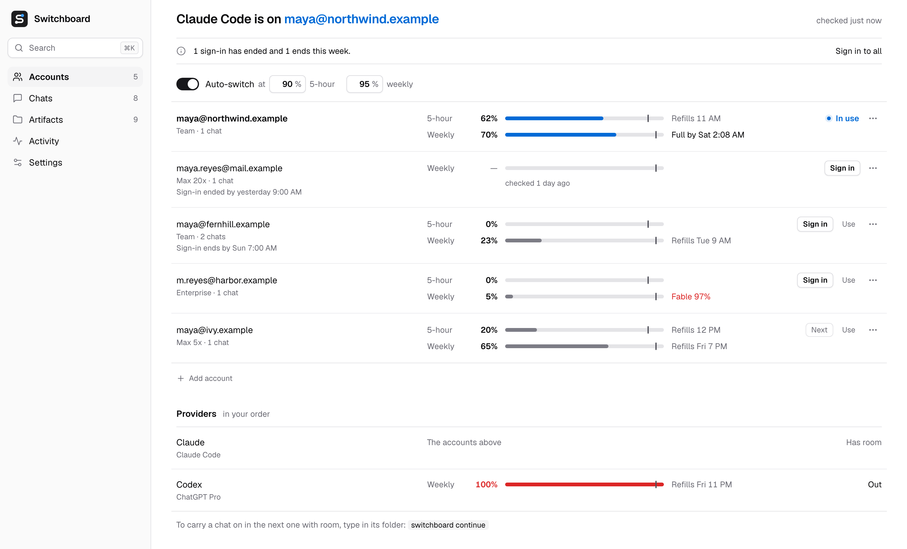

# <picture><source media="(prefers-color-scheme: dark)" srcset="docs/logo-dark.svg"></picture>

Switchboard shows the limits of every Claude account you use and moves Claude Code to the one with room.

- **Artifacts open as the account that made them.** Switchboard opens a claude.ai artifact in the browser profile signed in as its owner, and tells a Claude Code session that can't find one which account owns it.
- **Auto-switch waits for a pause.** It moves Claude Code at once only when it must, such as at a limit. Otherwise it waits until Claude Code is idle.
- **Run as any account.** `switchboard run work -- -p "…"` runs one Claude Code command as another account, without touching the login every other session uses.

```sh
brew install amyjainberkeley/apps/switchboard
```

For macOS, with Claude Code. No administrator needed. Then type `switchboard setup`. `switchboard demo` shows it with made-up accounts and changes nothing.

https://github.com/user-attachments/assets/5f6777d8-38f3-4380-81a6-9b7d1ae51000

One scene in the film, Models by the job (lookups on Haiku, reviews on Sonnet), comes in the next update.



## Install

Homebrew is the line above. Without Homebrew, this does the same and runs `switchboard setup` at the end:

```sh
curl -fsSL https://raw.githubusercontent.com/amyjainberkeley/switchboard/main/install.sh | sh
```

Homebrew checks the release file's SHA-256 before it puts anything on your Mac. The curl line, and `switchboard update` on an install without Homebrew, take the newest code on `main`, with no checksum.

Or paste this into Claude Code:

```text
Install Switchboard on this Mac: brew install amyjainberkeley/apps/switchboard
Without Homebrew: curl -fsSL https://raw.githubusercontent.com/amyjainberkeley/switchboard/main/install.sh | sh
Then run `switchboard setup` and `switchboard`, and tell me what they print.
```

## Quick start

`switchboard setup` (the one-line install runs it for you) ends with this, in your terminal:

```
Found Claude Code signed in as maya@northwind.example. Kept.
Notifications and the status line are on.
Sign in to your other accounts with /login in Claude Code. Each one is kept as you sign in.
```

The account Claude Code is on is kept without asking. To add another, sign in to it with `/login` in Claude Code: Switchboard keeps each login as you sign in, and a notification says so. `switchboard add` walks you through it if you prefer.

Once a second account is in, auto-switch turns on by itself. `switchboard auto off` turns it off, and it stays off.

Auto-switch moves Claude Code off an account once that account is over its switch line (by default 90% of the 5-hour limit, or 95% of the week), even an account you just picked yourself: within about a minute in a terminal, within a few minutes in VS Code. Under the default order, Refills first, it can also move Claude Code to an account whose week refills sooner, but only after Claude Code has been idle for 5 minutes, at least 45 minutes after the last switch (yours too), and at most twice in 6 hours. `switchboard auto out NAME` keeps an account out of auto-switch: Claude Code is never moved to it or off it by itself. `switchboard auto line NAME` gives an account lines of its own.

Signing out of Claude Code with `/logout` does not take an account out of Switchboard. `switchboard remove NAME` does.

Switchboard renews your logins by itself. Anthropic ends each sign-in by a set date, and renewing does not move it, so Switchboard shows that date a week ahead, on the page, in the menu bar and in `switchboard`, and says how to sign in again. A sign-in can end any time in the three days before that date.

## Usage

```
switchboard              every account; press its number to switch
switchboard switch 3     switch to account 3 (or give its email or name)
switchboard add          add accounts, one sign-in at a time
switchboard run 3 -- …   run one Claude Code command as account 3
switchboard open LINK    open a claude.ai artifact as the account that made it
switchboard auto         is auto-switch on? add on or off to change it
switchboard log          what happened: each switch and why (-f follows it)
switchboard page         open the page
switchboard doctor       check every part of the install
switchboard help         every other command
```

`sb` is the same command, shorter, with the same words. The installer adds it unless another program on your Mac already has the name; then it says so, and the command is `switchboard`.

Every command and flag: [docs/commands.md](docs/commands.md).

## How it works

Switchboard has three parts on your Mac:

- the account engine, which keeps each account's login, makes each switch and reads each account's limits;
- the page, which a background job keeps running. It keeps new logins, keeps every account's numbers current and runs auto-switch;
- the `switchboard` command and the menu bar item. The command works without the page; the menu bar item reads the page.

The page, the commands and the account engine are Python, standard library only. The menu bar item is drawn with PyObjC, and the link app is Swift. [How it works](docs/how-it-works.md) has every part in detail.

## What follows a switch

| | After a switch |
|---|---|
| A new Claude Code session, in a terminal or VS Code | Starts on the new account |
| A Claude Code session already open | Moves within about 30 seconds. If one doesn't, restart it. |
| An artifact or doc a session made | Stays with the account that made it. A session that can't find one is told which account owns it. |
| The Claude desktop app | Keeps its own sign-in |
| claude.ai in your browser | Keeps its own sign-in |

More in [how it works](docs/how-it-works.md#what-follows-a-switch).

## How fresh the numbers are

In a terminal, the account in use is live while you work: its numbers come from Claude Code itself, through Switchboard's status line. Where Claude Code shows no status line, as in its VS Code panel, the account in use is read from Anthropic like the others: every 5 minutes, about every 3 while the page is open, and at once when you open the page or press Read again. The other accounts are read every 5 to 15 minutes, more often near a switch line, and at once on Read again, or when you open the page and one of them was read over 5 minutes ago. Anthropic turns readings away when they come too often, so Switchboard keeps to about 20 reads an hour for each account. It reads whether auto-switch is on or off, with one account too. Each account shows when it was last checked.

## What it changes on your Mac

- `~/.switchboard`: the program, what it runs on, your settings and your list of accounts.
- The `switchboard` command, in `~/.local/bin` (with Homebrew, in Homebrew's bin folder), and its short name beside it.
- Switchboard.app, in Applications (below).
- Switchboard Links, the link app, in `~/Applications`. Once you say yes to macOS, it is your default browser: a claude.ai artifact you click opens as its owner, and every other link goes to the browser you used before. `switchboard links off` gives the seat back.
- Two background jobs that start at login: one for the page, one for the menu bar item.
- Your accounts' logins, in your Keychain, and any one-year token or API key you add as an account.
- At each switch, Claude Code's own login in your Keychain and the account named in `~/.claude.json`: that is how Claude Code moves.
- The page, which listens on this Mac only, at `localhost:7799` (`switchboard update --port N` moves it). With API keys and the keys gateway on, the gateway too, at port 7797.
- Claude Code's settings: a status line and three notification hooks. Each goes in by itself at the first run, but never over a status line of your own. `switchboard statusline off` and `switchboard notify off` take them out.
- Hooks that tell a Claude Code session which account owns an artifact it can't open, and what a switch means for it. They go in by themselves at the first run, beside hooks of your own. `switchboard hooks off` takes them out.
- When Claude Code's `settings.json` is a symbolic link, such as one kept with your dotfiles, none of these goes in by itself. `switchboard statusline on`, `switchboard notify on` and `switchboard hooks on` put them in.
- While Claude Code works, Switchboard keeps the Mac awake. `"awake": false` in `~/.switchboard/settings.json` turns that off.
- `~/.switchboard-notes`, once you carry a chat on in another assistant or hand it a job: the notes and the answers, which only you can read. A note goes after 30 days, an answer after 7. Removing everything takes this folder too.
- Only when you turn them on in the page's Settings: House rules and the Code map add a short block to `~/.claude/CLAUDE.md`; Sonnet for helpers changes a model setting in Claude Code's settings; claude-mem and the Code map download and install their own tools, which the page lists before you say yes. Turning one off, or removing Switchboard, takes it out again, except claude-mem's notes in `~/.claude-mem`.

## The Mac app

Switchboard.app goes in /Applications, or in ~/Applications when /Applications needs a password, so Spotlight and Launchpad find it. Opening it starts the menu bar item, or opens the page when the item is already running. The item shows two small bars for the account in use, and every account in its menu.

## Privacy

- Logins and API keys stay in your Keychain, except in a file you ask for: `switchboard export` writes your accounts' logins to one file protected with a passphrase, to carry to another Mac. Switchboard's own files keep only each key's name and last four characters, and no login, unless the Keychain refuses one: then a recovery copy goes in a file only you can read.
- It sends nothing of yours off your Mac except to Anthropic, to key providers you add, and, when you use another assistant through it, to that assistant's maker: a note of a chat you carry on, or a job you hand over, goes to OpenAI through Codex only after your yes for that folder, and `switchboard providers --ask` has Codex ask OpenAI for its own limits. No telemetry. A look for a newer version is off until you turn it on (`switchboard config set update_check daily`); it, and `switchboard update --check`, ask only the place an update would come from, for its version number. A preview of a page you published loads that page's own scripts and fonts from the public code sites claude.ai allows, as your browser does when you open it.
- It never shows a login form. Signing in is Claude Code's own, on claude.ai.
- The chat search keeps an index of your chats' words on this Mac, readable only by you. History keeps no prompt, chat text, login or key.
- To show each chat's account and title, and for the chat search, it reads Claude Code's chat files on this Mac. For Codex's numbers it reads Codex's session files. It never opens Codex's login file.
- The page's server answers any program on this Mac, including one run by another user of this Mac, and lets it do what the page does. Other websites cannot reach it. [SECURITY.md](SECURITY.md) has this and the other known gaps.

More: [what it keeps and what it downloads](docs/how-it-works.md#privacy).

## Not for you if

- You use Windows or Linux. Switchboard is for macOS only.
- You don't use Claude Code.
- Your company locks Claude Code to its organization (`forceLoginOrgUUID`): Claude Code then refuses accounts in other organizations.

Check that using several accounts fits Anthropic's terms. If you carry work to Codex, check OpenAI's too: the [FAQ](docs/faq.md#is-using-codex-through-switchboard-allowed-by-openais-terms) says what Switchboard starts there.

## Update and remove

| To | With Homebrew | Without |
|---|---|---|
| Update | `brew upgrade switchboard` | `switchboard update` |
| Remove it, keep your accounts, settings and history | `brew uninstall switchboard` | `sh ~/.switchboard/app/uninstall.sh` |
| Remove it all, with your accounts' logins | `brew uninstall --zap switchboard` | `sh ~/.switchboard/app/uninstall.sh --all` |

An update installs the newest version the way you installed it, with the same choices; your accounts and settings stay. With Homebrew, `switchboard update` runs `brew upgrade switchboard` for you. Removing takes out the program, Switchboard.app, the link app, the background jobs and the command, and puts back what Switchboard changed in Claude Code. It never touches the login Claude Code is using. A plain remove leaves a copy of the uninstaller beside what it kept, so `sh ~/.switchboard/uninstall.sh --all` removes the rest later. It also keeps the notes of chats you carried on in another assistant (`~/.switchboard-notes`) and says so; removing it all takes them too.

## Help

Run `switchboard doctor`. It checks every part and says what to do about anything wrong. If that doesn't fix it, [open an issue](https://github.com/amyjainberkeley/switchboard/issues) and paste what doctor printed: it shows no login or key. It does show your accounts' email addresses, so take them out first if you don't want them public.

## Documentation

[How it works](docs/how-it-works.md) · [Commands](docs/commands.md) · [Troubleshooting](docs/troubleshooting.md) · [FAQ](docs/faq.md) · [Changelog](CHANGELOG.md)

## Contributing

Bug reports and pull requests are welcome. [CONTRIBUTING.md](CONTRIBUTING.md) says how the code is laid out, how to run the tests and what a change needs. Report a security problem privately: [SECURITY.md](SECURITY.md).

## License

MIT. [Credits](docs/credits.md) lists what Switchboard runs on.

Switchboard is not affiliated with Anthropic or OpenAI. Claude is a trademark of Anthropic. Codex and ChatGPT are trademarks of OpenAI.
